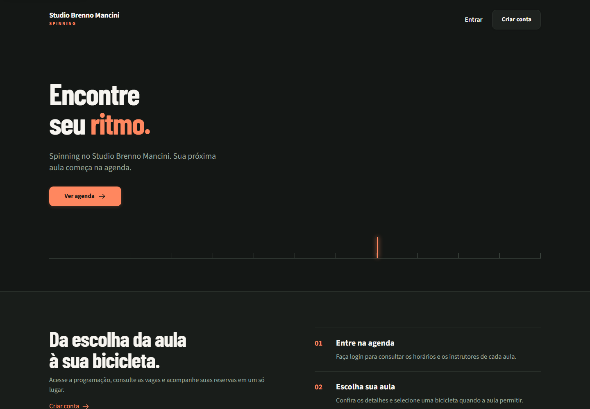
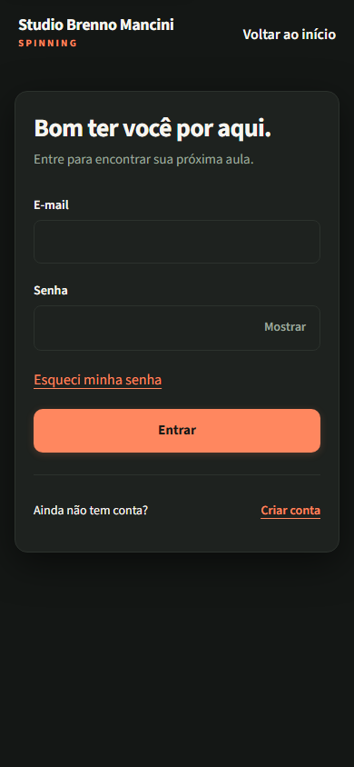
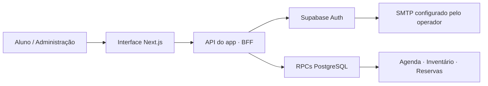

<div align="center">


# Studio Brenno Mancini Spinning

**Escolha sua aula. Reserve sua bicicleta. Acompanhe seu ritmo.**

Plataforma web para organizar a experiência dos alunos e a operação diária do Studio.

[Acessar o app](https://studio-brenno-mancini-spinning.vercel.app) · [Funcionalidades](#funcionalidades) · [Executar localmente](#executar-localmente) · [Segurança](#segurança-e-qualidade)

    [](https://github.com/bentomancini/studio-brenno-mancini-spinning/actions/workflows/backend.yml)

</div>

## O projeto

O **Studio Brenno Mancini Spinning** reúne agenda, disponibilidade de bicicletas, reservas e presença em uma aplicação acessível pelo navegador. O aluno encontra sua próxima aula; a administração acompanha os cadastros e organiza a operação do Studio.

A interface usa tons escuros e laranja, navegação adaptada para celular e formulários com feedback de carregamento, sucesso e erro. A disponibilidade é conferida pelo servidor no momento da reserva.

## Por dentro da interface

<table>
  <tr><th>Desktop · apresentação</th><th>Mobile · acesso</th></tr>
  <tr>
    <td width="72%"></td>
    <td width="28%"></td>
  </tr>
</table>

*Capturas reais de páginas públicas em execução local. Nenhum dado de aluno ou credencial aparece nas imagens.*

## Funcionalidades

| Para quem pedala | Para quem organiza |
| :--- | :--- |
| Cadastro, login e recuperação de senha | Visão geral da operação diária |
| Agenda por dia ou semana e filtro por instrutor | Criação, edição e cancelamento de aulas |
| Consulta de vagas e seleção de bicicleta | Gestão de alunos, instrutores e bicicletas |
| Reserva e cancelamento conforme as regras do Studio | Reservas em nome do aluno, conforme autorização |
| Próximas reservas e histórico | Registro de presença e ausência |
| Edição do perfil e navegação mobile | Configuração das políticas de reserva |

### Um fluxo simples

**Entrar → Ver agenda → Escolher aula → Selecionar bicicleta, quando exigido → Confirmar reserva.**

Uma seleção não bloqueia a vaga. A confirmação aparece depois da resposta do servidor. Em falha de conexão, o app permite consultar o resultado e repetir a mesma solicitação sem criar outra intenção de reserva.

## Como funciona



| Camada | Tecnologias |
| :--- | :--- |
| Interface | Next.js App Router, React, CSS Modules |
| Contratos | TypeScript e Zod |
| Identidade | Supabase Auth, cookies HttpOnly e PKCE/OTP |
| Dados | PostgreSQL, migrações SQL e operações transacionais |
| Testes | Vitest, Playwright e PostgreSQL nativo descartável |
| Verificação contínua | GitHub Actions |

## Executar localmente

**Requisitos:** Node.js 22.13+ da série 22 ou Node.js 24; npm 10 ou 11.

```bash
git clone https://github.com/bentomancini/studio-brenno-mancini-spinning.git
cd studio-brenno-mancini-spinning
npm ci --ignore-scripts
```

1. Crie `.env.local` usando [`.env.example`](.env.example) como referência.
2. Configure um ambiente Supabase de desenvolvimento e aplique as migrações em ordem, seguindo o [guia de configuração](docs/SETUP.md).
3. Configure as URLs de retorno e o SMTP para confirmação e recuperação por e-mail.
4. Inicie a aplicação:

```bash
npm run dev
```

Abra **http://localhost:3000**.

> As chaves de serviço ficam somente no servidor. Não use variáveis `NEXT_PUBLIC_` para elas nem publique `.env.local`. Sem configuração, o build funciona, mas os serviços dependentes do Supabase retornam indisponibilidade.

## Segurança e qualidade

- Autorização no backend e isolamento das reservas por usuário.
- Validação de entradas, proteção de origem das requisições e limites de tentativas.
- Cookies HttpOnly/SameSite e Secure em produção; respostas privadas sem cache.
- Operações transacionais com controle de capacidade, duplicidade e concorrência.
- Chaves de idempotência e verificação de versão para evitar repetição e sobrescrita indevida.
- Testes de recuperação, revogação de sessão, permissões e troca de conta entre abas.

**Veja os resultados, correções e limites da revisão em [Security review — 07/11/2026](docs/SECURITY-REVIEW-2026-11-07.md).** Um teste local aprovado não equivale a uma certificação de segurança ou a uma auditoria completa da infraestrutura publicada.

```bash
npm run typecheck
npm run lint
npm test
npm run build
npm run test:runtime
npx playwright install chromium
npx playwright test --config tests/browser/all.config.ts
```

`npm test` usa PostgreSQL descartável e contratos controlados de autenticação. `test:provider` exige Supabase local real configurado e informa bloqueio quando o ambiente não está disponível. Não dispara testes sobre contas de alunos em produção.

<details>
<summary><strong>Estrutura do repositório</strong></summary>

```text
src/
├── app/             Rotas públicas, aluno, admin e API
├── components/      Telas e componentes compartilhados
├── contracts/       Contratos e validações
├── lib/server/      Integrações e controles do servidor
├── lib/ui/          Estado e comunicação da interface
└── modules/         Identidade e reservas
supabase/migrations/ Estrutura e regras transacionais
tests/               Testes unitários, SQL e navegador
docs/                Arquitetura, operação e evidências
```

</details>

## Documentação

| Guia | Conteúdo |
| :--- | :--- |
| [Configuração](docs/SETUP.md) | Ambiente, Supabase, SMTP e primeiro administrador |
| [API](docs/API.md) | Rotas, validações, versões e erros |
| [Banco](docs/DATABASE.md) | Persistência, concorrência e recuperação |
| [Frontend](docs/FRONTEND.md) | Telas, componentes e decisões da interface |
| [Segurança](docs/SECURITY.md) | Controles, fronteiras e riscos residuais |
| [Revisão atual](docs/SECURITY-REVIEW-2026-11-07.md) | Evidências executadas e pendências |
| [Fontes](docs/FONT-LICENSES.md) | Licenças da tipografia auto-hospedada |

### Limites do produto

As políticas de reserva precisam ser configuradas pelo Studio. O projeto não inclui pagamentos, planos, créditos, lista de espera ou recorrência automática. Arquivar um cadastro preserva o histórico; não representa exclusão definitiva. O acesso à agenda exige conta, e reservas não são enviadas offline.

---

<div align="center">

**Studio Brenno Mancini · Spinning**<br />
Desenvolvido por [Bento Mancini](https://github.com/bentomancini)

</div>
